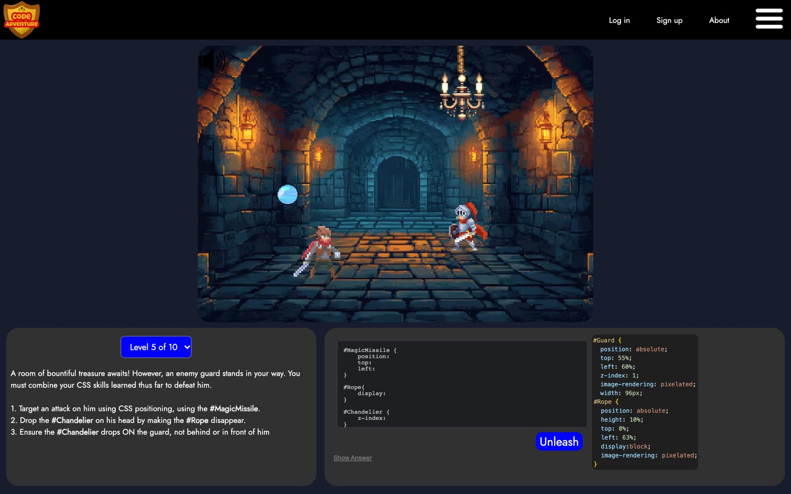

# Code Adventure

**A pixel-art adventure game that teaches CSS.** You solve every puzzle by writing real CSS, and the adventurer acts out your code: claim a sword, break out of a cage, find a hidden passage, fix a bridge, then take on a dungeon guard.

**[Play it](https://code-adventure-rohit.vercel.app/index.html)** · [Demo video](https://www.youtube.com/watch?v=WS1A4rPcEKs)



## How it plays

| Level | What you learn | The puzzle |
| --- | --- | --- |
| 1 | `top` and `left` | Move the adventurer onto the sword in the stone |
| 2 | `z-index` | Lift him above the cage to break out |
| 3 | `display` | Reveal the hidden passage |
| 4 | `transform: rotate()` | Turn the bridge so he can cross |
| 5 | All of the above | Aim a magic missile, cut the rope and drop the chandelier on the guard |

- Type CSS into the editor and submit it. A correct answer plays an animated scene with sound, and **Show Answer** helps if you're stuck.
- Sign up and your progress is saved. Log back in and you pick up at your last level.
- Levels 1–5 are playable. Levels 6–10 and the HTML and JavaScript tracks are still to come.

## Background

Code Adventure started as my high-school project in 2023, with the first two levels, sprite animations and accounts. In 2025 I came back to it and added levels 3–5 (including the boss fight), sound effects and music, level locking and analytics.

## Built with

HTML · CSS · JavaScript (ES modules) · Firebase Authentication and Firestore · Vercel

## Running locally

It's a static site, so any local server works:

```bash
python3 -m http.server 8000
```

Then open http://localhost:8000. Levels 2–5 need you to be signed in.
